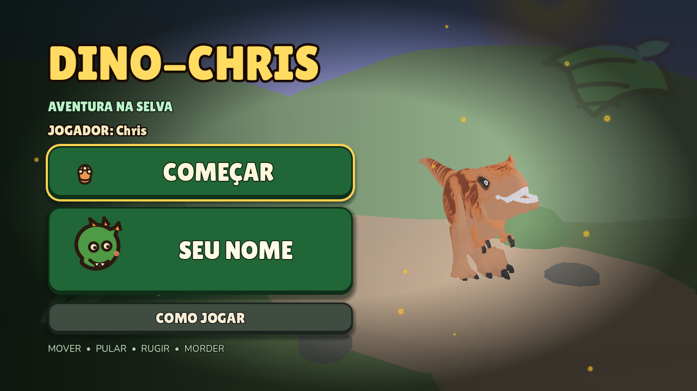
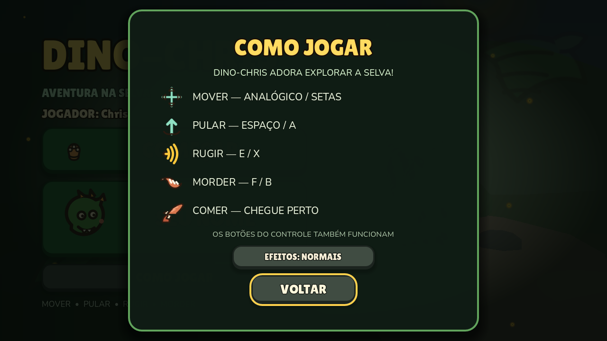
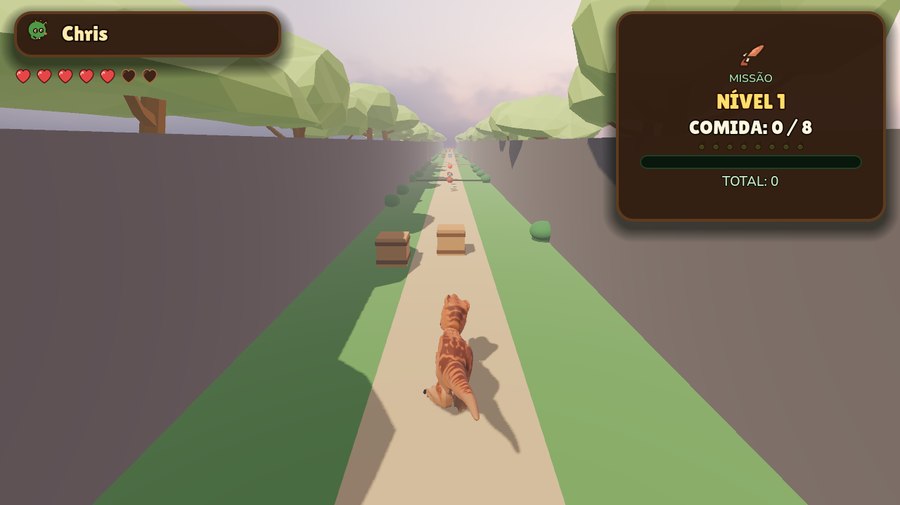
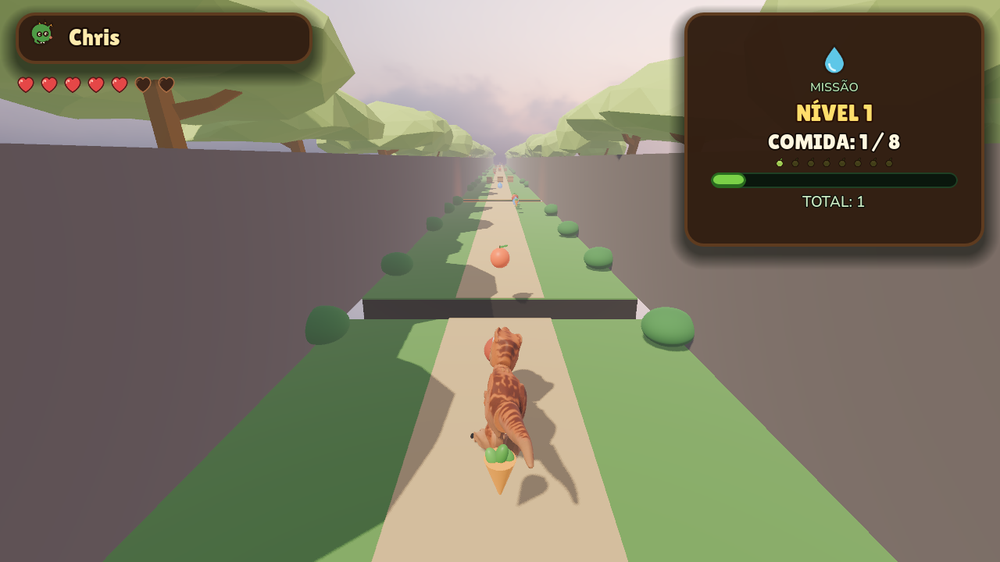
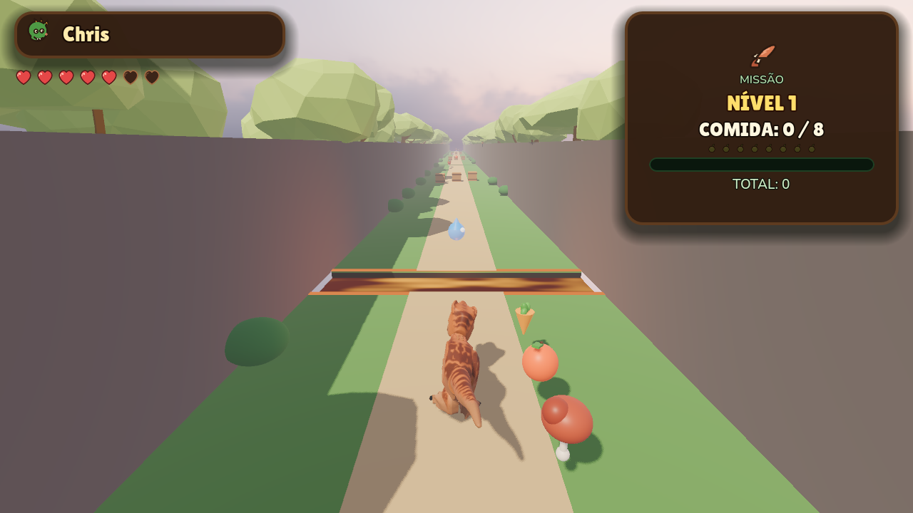
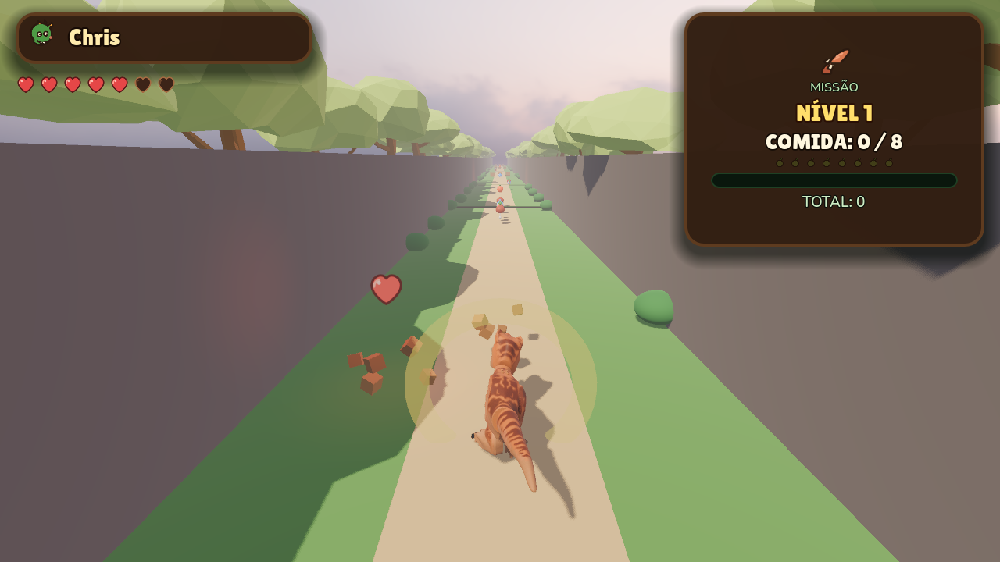
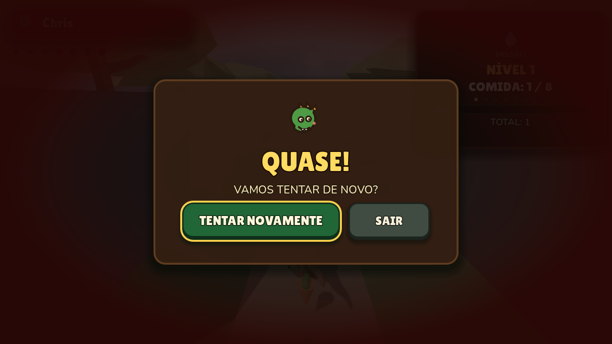

<p align="center">
  
</p>

<h1 align="center">Dino-Chris</h1>

<p align="center">
  <strong>Aventura na Selva</strong> — um corredor 3D infinito feito para um fã de T-Rex de 4 anos.
</p>

<p align="center">
  
  
  
  
</p>

---

## Sobre o jogo

**Dino-Chris** é um jogo de corrida 3D em Godot 4 pensado para ser a primeira aventura de uma criança de 4 anos. O objetivo é simples: atravessar uma selva infinita, rugir, morder, quebrar caixas e comer comidas saudáveis — com vidas generosas, controles fáceis e um game over fofo que nunca pune de verdade.

A inspiração é o corredor do Crash Bandicoot, mas sem cronômetro, sem plataformas milimétricas e sem texto longo. A criança aprende andando: a comida em trilha mostra o caminho, as caixas ensinam o rugido e a fissura ensina o pulo.

O jogo começa com **5 corações** (até **7**), cada erro custa no máximo **1 coração**, e o dino só anda quando o jogador manda. Nada de corrida automática.

## O que tem no jogo

- **Corredor infinito procedural** — trechos de 36 m com chão, paredes, árvores, caixas, comidas, fissuras e rios de lava. Os trechos antigos são reciclados, então a fase roda para sempre sem crescer em memória.
- **Missão de comer bem** — carne, fruta, vegetal e água aparecem em trilhas. O nível 1 pede 8 comidas; cada nível seguinte pede uma a mais (até 15). O HUD mostra nível, contador, barra de progresso e total.
- **Vidas generosas** — 5 corações iniciais, máximo de 7. Caixas podem soltar corações de cura (40% de chance; 100% com 1 ou 2 vidas; nenhum com 7).
- **Erro sem punição** — cair numa fissura, encostar na lava ou trombar num tronco tira 1 coração e devolve o dino logo depois do obstáculo, com 1,5 s de invulnerabilidade.
- **Rugido e mordida** — o rugido quebra tudo num raio de 3,5 m; a mordida quebra a caixa da frente. Também dá para quebrar caixas correndo contra elas.
- **Trilha sonora original** — quatro temas em loop (menu, partida, modo calmo e game over), com crossfade entre telas e volumes separados para música e efeitos.
- **Anti-softlock** — se o dino ficar 3 s preso com o avanço segurado, ele volta ao último ponto seguro **sem perder vida**.
- **Game over fofo** — ao chegar a 0 corações aparece **QUASE!**, com **TENTAR NOVAMENTE** (recomeça com 5) e **SAIR** (volta ao menu). Não há contador de mortes nem cronômetro.
- **Nome do jogador** — o menu permite digitar o nome (até 16 letras), salvo em `user://dados.cfg` e exibido no HUD.
- **Acessibilidade** — botões grandes, foco amarelo, teclado e controle, D-pad como alternativa ao analógico, e um botão **EFEITOS: SUAVES** no painel de controles que reduz partículas e usa a trilha calma na fase.
- **Feedback exagerado** — animações, sons, poeira, onda de choque, tremor de câmera e caixas voando.

## Telas

| | |
|---|---|
|  <br> **Como Jogar** — painel com os controles e o modo de efeitos |  <br> **Corredor infinito** — caixas, comidas e a selva ao fundo |
|  <br> **Fissura** — o buraco no chão pede um pulo |  <br> **Lava** — rio brilhante com shader animado e luz laranja |
|  <br> **Rugido** — onda de choque e caixa quebrada |  <br> **Quase!** — game over com TENTAR NOVAMENTE e SAIR |

## Controles

O dino **não anda sozinho**: o avanço é manual. Segure para frente para correr e solte para parar.

| Ação | Teclado | PlayStation | Xbox / controle genérico |
|---|---|---|---|
| Mover | `W` `A` `S` `D` ou setas | Analógico esquerdo ou D-pad | Analógico esquerdo ou D-pad |
| Pular | `Espaço` | `X` (Cruz) ou `B` (Bola) | `A` ou `B` |
| Rugir | `E` | `Quadrado` ou `Triângulo` | `X` ou `Y` |
| Morder | `F` | `L1` ou `R1` | `LB` ou `RB` |
| Comer | Apenas chegue perto da comida | — | — |

O Godot usa a nomenclatura de layout Xbox internamente, mas detecta o controle PlayStation automaticamente via SDL. Não é preciso plugin nem configuração. O analógico tem deadzone de 0.25 para o dino não andar sozinho.

## Como rodar

### Requisitos

- **Godot 4.7 ou mais recente**, versão padrão (sem C#). O projeto foi validado na **4.7.2**.
- Windows para a experiência testada. O projeto deve abrir em Linux/macOS, mas o alvo atual é o PC.
- Nenhuma dependência externa: modelos, fontes, áudio, céu e shader já estão no repositório.

### Pelo editor

1. Baixe o [Godot 4.7+ standard](https://godotengine.org/download).
2. Abra o Godot, clique em **Importar** e selecione o `project.godot` deste repositório.
3. Aperte **F5**. A tela inicial abre com **COMEÇAR**, **SEU NOME** e **COMO JOGAR**.

### Pela linha de comando

```powershell
godot --path .
```

Se o executável não estiver no `PATH`, chame o caminho completo:

```powershell
& "C:\caminho\para\Godot_v4.7.2-stable_win64.exe" --path .
```

O nome do jogador fica em `%APPDATA%\Godot\app_userdata\Dino-Chris\dados.cfg`. Apagar esse arquivo só zera o nome; as vidas são sempre da sessão e não são salvas.

## Estrutura do projeto

```text
.
├── project.godot                  # Configuração, Input Map, camadas, tema e autoloads
├── icon.svg
├── inicio.md                      # Documento de design e decisões técnicas (leitura recomendada)
├── scenes/
│   ├── tela_inicial.tscn          # Menu com diorama 3D, nome e painel de controles
│   ├── diorama_menu.tscn          # Cenário animado do menu
│   ├── fase_1.tscn                # Céu, luz, T-Rex, corredor, HUD e game over
│   ├── jogador.tscn               # CharacterBody3D + modelo rigado + câmera
│   ├── caixa.tscn                 # Caixa quebrável
│   ├── coletavel.tscn             # Comida (carne, fruta, vegetal, água)
│   ├── coracao.tscn               # Coração de cura
│   └── tronco.tscn                # Obstáculo que empurra e tira vida
├── scripts/
│   ├── jogador.gd                 # Movimento, pulo, ataques, dano, vidas e missão
│   ├── corredor.gd                # Gerador procedural infinito
│   ├── hud.gd                     # Nome, corações, nível, contador e barra
│   ├── fase.gd                    # Anti-softlock, game over e troca de cena
│   ├── tela_inicial.gd            # Botões, painel de nome e painel de controles
│   ├── menu_diorama.gd            # Câmera e animação do menu
│   ├── caixa.gd                   # Destruição, destroços e coração de cura
│   ├── coletavel.gd               # Desenho e coleta das comidas
│   ├── coracao.gd                 # Cura e tempo de vida
│   ├── tronco.gd                  # Dano e empurrão
│   ├── game_over.gd               # Overlay de fim de vidas
│   ├── camera_tremer.gd           # Tremor de câmera
│   ├── dados.gd                   # Autoload: nome do jogador
│   └── sons.gd                    # Autoload: efeitos 2D e 3D
├── assets/
│   ├── modelos/jogador/           # T-Rex original + T-Rex rigado com 6 animações
│   ├── modelos/props/             # Árvores, caixa, barril e rochas
│   ├── modelos/inimigos/          # SpinoBob (ainda não usado em jogo)
│   ├── shaders/lava.gdshader      # Lava animada
│   ├── fontes/                    # Lilita One + Nunito SemiBold (OFL) e tema global
│   ├── ceu/ceu-01.exr             # Panorama HDRI do céu
│   └── ui/                        # Ícones SVG do HUD e do menu
├── audio/                         # 6 efeitos WAV + 4 trilhas OGG originais
├── tests/                         # 9 harnesses headless + captura visual
├── tools/rig/                     # Pipeline Blender que gera o rig e as animações
├── tools/audio/                   # Compositor que gera a trilha sonora
└── docs/img/                      # Imagens usadas neste README
```

O `inicio.md` detalha cada sistema, os ajustes rápidos no inspetor, as descobertas dos testes e o passo a passo do rig. Vale ler antes de mexer no projeto.

## Como o jogo funciona por dentro

- **Corredor procedural** — `scripts/corredor.gd` monta trechos de 36 m, mantém alguns prontos à frente e libera os que ficaram 58 m para trás. Cada trecho usa um único `StaticBody3D` com colisões de chão e paredes. A semente 0 sorteia um caminho novo; um número fixo repete o mesmo percurso.
- **Ritmo dos desafios** — o começo é roteirizado (caixas, fissura, lava, caixas) para ensinar sem texto. Depois, o sorteio alterna fissura, lava, caixas e trecho livre, com pelo menos 20 m entre desafios. A largura máxima cresce com a distância percorrida.
- **Dificuldade calibrada** — velocidade de 6 m/s, pulo de 7,5 e gravidade 24 fazem o dino cobrir cerca de 3,7 m no ar. Nenhum buraco passa de 2,6 m, então sobra margem de aproximadamente 1,1 m.
- **Dino rigado** — o T-Rex tem 23 ossos e 6 clipes (`Idle`, `Walk`, `Run`, `Jump`, `Attack`, `Roar`), gerados no Blender 5.2 por um pipeline Python próprio em `tools/rig/`. O `CharacterBody3D` move o personagem; as animações não têm root motion.
- **Lava convincente** — o rio fica apenas 28 cm abaixo do chão, com shader `unshaded`, dois ruídos correndo no sentido do rio, faixas emissivas nas margens e uma luz laranja. Mais fundo, a borda esconderia o rio na câmera de trás.
- **Céu HDRI** — panorama equiretangular 1024×512 com tonemap AgX e névoa configurada com `fog_sky_affect = 0.0` para o céu não virar uma cor chapada.
- **Áudio próprio** — os seis efeitos e as quatro trilhas são sintetizados no projeto, sem samples de terceiros. O autoload `Sons` separa música e efeitos nos buses `Music` e `SFX`, liga o loop dos OGG e faz o crossfade mesmo com o jogo pausado no game over.
- **Interface** — tema global com **Lilita One** nos títulos e **Nunito SemiBold** no texto, ambos sob SIL Open Font License.

## Testes automáticos

O projeto tem 9 harnesses headless. Todos passam com código 0:

| Teste | O que valida |
|---|---|
| `harness.tscn` | Corredor completo: geração, câmera, controles, pulo, árvores, fissura, lava, rugido, coleta, dano, respawn, 600 m gerados e limites |
| `harness_menu.tscn` | Menu, botões, painel de nome, persistência e trilha do menu |
| `integracao_menu.tscn` | **COMEÇAR** carrega a fase, o nome aparece no HUD e a trilha correta toca |
| `harness_missao.tscn` | Comidas nos 4 tipos, HUD, barra, contador e subida de nível |
| `harness_mordida.tscn` | 6 animações, loops, mordida no teclado/controle, rugido, mordida no ar e troca Idle/Run |
| `harness_ceu.tscn` | Panorama HDRI, névoa fora do céu, tonemap AgX e sombra do sol |
| `harness_tronco.tscn` | Dano, empurrão e invulnerabilidade |
| `harness_vidas.tscn` | 7 espaços de coração, 5 iniciais, cura, teto 7, danos, respawn, game over e trilha |
| `harness_audio.tscn` | Buses `Music`/`SFX`, 4 trilhas carregadas, duração, loop OGG, troca e parada |

Para rodar todos:

```powershell
$testes = @(
  "harness",
  "harness_menu",
  "integracao_menu",
  "harness_missao",
  "harness_mordida",
  "harness_ceu",
  "harness_tronco",
  "harness_vidas",
  "harness_audio"
)

foreach ($teste in $testes) {
  & godot --headless --path . "res://tests/$teste.tscn"
}
```

Para QA visual, `tests/captura.tscn` abre a fase (com janela) e salva prints em `tools/rig/out/`, que é ignorado pelo Git.

## Roadmap

- [ ] Animação de comer ao pegar a comida.
- [ ] Rigar e animar o SpinoBob reaproveitando o pipeline de `tools/rig/`.
- [ ] Fase 2 com perseguição invertida (o T-Rex atrás de uma fruta gigante).
- [ ] Controle de volume de música e efeitos e um efeito de "uau" ao subir de nível.
- [ ] Exportar `.exe` para Windows com o ícone do T-Rex.

## Créditos e licenças

- **Feito com carinho para o Chris.**
- **Godot Engine** — motor do jogo, licença MIT.
- **Modelos 3D** — T-Rex do jogador, SpinoBob, árvores e props foram importados do Sketchfab. As licenças originais dos autores não estão documentadas no repositório; confira antes de redistribuir os arquivos.
- **Fontes** — Lilita One e Nunito SemiBold sob SIL Open Font License. Os textos das licenças estão em `assets/fontes/OFL-*.txt`.
- **Áudio** — efeitos e trilhas gerados por síntese dentro do projeto, sem samples de terceiros. O compositor fica em `tools/audio/gerar_musica.py`.
- **Céu HDRI** — arquivo incluído em `assets/ceu/ceu-01.exr`; a origem e a licença não estão documentadas no repositório. Verifique antes de redistribuir.

Este repositório **não possui um arquivo `LICENSE`**: o código e os assets não têm uma licença de uso definida. Se quiser reutilizar alguma parte, fale com o autor primeiro.
